<a href="https://www.linkedin.com/in/enrico-mannarino/"></a>

  &nbsp;&nbsp;
  

<a href="https://www.linkedin.com/in/enrico-mannarino/"></a>

<h3 align="center">Tech stack</h3>

<table align="center">
  <tr>
    <td align="right"><b>LANGUAGES</b></td>
    <td>
      <a href="https://www.python.org"></a>
      <a href="https://www.r-project.org"></a>
      <a href="https://www.gnu.org/software/bash/"></a>
    </td>
  </tr>
  <tr>
    <td align="right"><b>ML &amp; LLMs</b></td>
    <td>
      <a href="https://pytorch.org"></a>
      <a href="https://www.tensorflow.org"></a>
      <a href="https://scikit-learn.org"></a>
      
      
    </td>
  </tr>
  <tr>
    <td align="right"><b>INFRA &amp; MLOPS</b></td>
    <td>
      
      
      <a href="https://www.kubeflow.org"></a>
      
      <a href="https://about.gitlab.com"></a>
    </td>
  </tr>
  <tr>
    <td align="right"><b>DATA</b></td>
    <td>
      
      
      
    </td>
  </tr>
</table>

<a href="#"></a>
